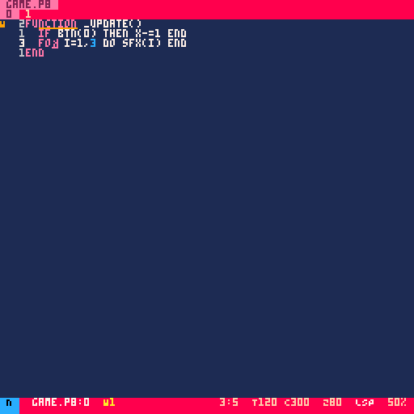
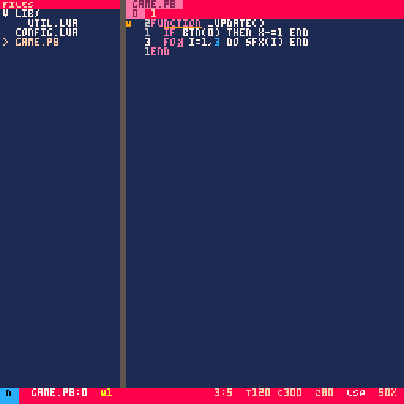

# pico-editor

A native PICO-8 code editor that feels like the built-in PICO-8 editor, with
semantic highlighting, pico-lsp language intelligence, a simple file tree, Vim
editing, and authentic P8SCII input. One Go binary, no WebView.

> PICO-8 is a trademark of Lexaloffle Games. This project is not affiliated
> with, sponsored by, or endorsed by Lexaloffle Games.

**Status:** M7 implemented. Automated checks pass; interactive X11/Wayland
spot checks from M1 are tracked in
[docs/spikes/M1-input.md](docs/spikes/M1-input.md), the M3 manual checklist is
in [docs/spikes/M3-vim.md](docs/spikes/M3-vim.md), the M4 cart/tree checklist is
in [docs/spikes/M4-cart.md](docs/spikes/M4-cart.md), the M5 LSP checklist is in
[docs/spikes/M5-lsp.md](docs/spikes/M5-lsp.md), and the M6 input checklist is in
[docs/spikes/M6-input.md](docs/spikes/M6-input.md). M7 automated verification
and the remaining manual checklist are in
[docs/spikes/M7-polish.md](docs/spikes/M7-polish.md). pico-lsp runs in-process:
editing a cart or include gets semantic highlighting, diagnostics, completion,
hover, signature help, and go-to-definition, with token/character/compressed
sizes in the status row. P8SCII input includes Shift+letter glyphs, Ctrl+J/K
kana, Ctrl+P puny mode, a complete glyph picker, and `p8_left` completion; see
[docs/INPUT.md](docs/INPUT.md). M7 adds TOML settings and keymaps, a redesigned
semantic status bar and notifications, the command palette, refresh-on-focus,
crash recovery, rotating logs, documentation, and the final performance pass.
Next is M8 (Linux release).





V1 features:

- Open a project folder and browse `.p8` and `.lua` files in a simple tree.
- Edit `.p8` carts as PICO-8 code tabs; save without touching other sections.
- Semantic highlighting, diagnostics, completion, hover, signature help, and
  go-to-definition from in-process pico-lsp.
- A curated Vim core with visual char/line/block, text objects, registers,
  search, undo/redo, `:s`, and basic ex commands.
- Authentic P8SCII input: Shift+letter glyphs, kana/puny modes, glyph picker,
  and `p8_left` completion.
- TOML settings, rebindable global keys, command palette, notifications,
  refresh-on-focus, error dialogs, crash recovery, and rotating logs.
- Linux AppImage and tar.gz releases with install/run documentation (M8).

With no argument the current directory opens as a workspace with the file tree
focused. Pass a `.p8` cart, `.lua` include, or directory to start there:

```sh
mise exec -- go run ./cmd/pico-editor path/to/game.p8
mise exec -- go run ./cmd/pico-editor path/to/project
```

The M1 charset demo is still available with `--debug-charset`: `1`–`4` change
the window scale, `W` toggles the width overlay, `P` cycles the background
palette, and the arrow keys move the selection.

In the editor, `:help` lists the core keys. Use `i`/`a` to insert, `Esc` to
return to normal mode, `:w` to save, `:q` to close (or `:q!` to discard), and
`:wq`/`:x` to write and close. `Ctrl+S` saves the current buffer. `Ctrl+Tab` and
`Ctrl+Shift+Tab` move between cart code tabs; `Ctrl+Shift+B` toggles the file
tree. `Ctrl+Shift+P` opens the command palette, `Ctrl+Shift+M` opens message
history, and `F1` opens help. `Ctrl+Q` and the window close button offer Save
all / Discard all / Cancel when buffers are dirty. Carts save only the `__lua__`
body; the header and every other section are preserved byte-for-byte. `.p8.png`
remains unsupported. `K` shows hover, `gd`/`Ctrl+]` jumps to a definition,
`Ctrl+Space` opens completion in insert mode, `:diag` lists diagnostics, and
`:lsp restart` restarts the in-process language server. Settings and keymaps
live in TOML; see [docs/CONFIG.md](docs/CONFIG.md) and
[docs/KEYMAP.md](docs/KEYMAP.md). Dirty buffers are journaled for crash
recovery, and `:messages`, `:reload`, and `:help config`/`:help troubleshooting`
cover the rest.

## Requirements

- Linux (V1 target; the editor layer is kept portable).
- [mise](https://mise.jdx.dev/) for the pinned Go 1.27.4 toolchain and
  `golangci-lint`.
- A working OpenGL environment. Ebitengine selects Wayland or X11
  automatically. Clipboard access is pure Go; on GNOME Wayland it uses
  XWayland, and it degrades to internal registers when unavailable.

## Build and run

```sh
mise install
mise run build     # bin/pico-editor
mise run run       # opens the current directory workspace
mise exec -- go run ./cmd/pico-editor path/to/file.lua
```

`Ctrl+Q` or closing the window quits.

Available tasks:

| Task | Purpose |
| --- | --- |
| `mise run build` | Build `bin/pico-editor` |
| `mise run run` | Run from source |
| `mise run test` | `go test ./...` |
| `mise run lint` | `golangci-lint run` |
| `mise run fmt` | `gofmt -w .` and `go mod tidy` |
| `mise run check` | Format check, lint, test, and build (the gate) |

## Version metadata

Development builds report `pico-editor dev (unknown, unknown)`. Release builds
inject the version, commit, and build date into
`github.com/asimmons91/pico-editor/internal/version` with `-ldflags`.

## Documentation

- [Roadmap and V1 scope](docs/ROADMAP.md)
- [Usage and quick start](docs/USAGE.md)
- [Configuration reference](docs/CONFIG.md)
- [Keymap and command IDs](docs/KEYMAP.md)
- [Troubleshooting](docs/TROUBLESHOOTING.md)
- [Architecture and invariants](docs/ARCHITECTURE.md)
- [Frozen Vim command matrix](docs/VIM.md)
- [P8SCII input and capture notes](docs/INPUT.md)
- [Notices and attributions](NOTICE)
- [M1 input and rendering spike results](docs/spikes/M1-input.md)
- [M3 Vim manual checklist](docs/spikes/M3-vim.md)
- [M4 cart and file tree checklist](docs/spikes/M4-cart.md)
- [M5 in-process LSP checklist](docs/spikes/M5-lsp.md)
- [M6 input capture and checklist](docs/spikes/M6-input.md)
- [M7 verification and manual checklist](docs/spikes/M7-polish.md)
- [Screenshots](docs/images/)
- [License](LICENSE)

## Contributing

- `main` is protected. Create a branch, push it, and open a PR; never push
  directly to `main`.
- Use Conventional Commits: `<type>(<optional scope>): <description>`.
- CI runs `mise run check` on pushes to `main` and on every pull request, and
  it must be green before merge.
- Each PR gets a focused code review before merging. Review fixes go on the
  same branch and PR.
- Golden tests are required for cart round-trips, P8SCII glyph coverage and
  widths, and Vim behavior.

## License

MIT. See [LICENSE](LICENSE) and [NOTICE](NOTICE) for the PICO-8 font and
trademark attribution.
